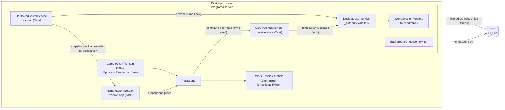

# Engine And Client/Server Architecture Review

Purpose: A whole-system review of the `dream` engine and its client/server design, focused on functional correctness and performance. Security is out of scope by request.

Status: Analysis only. No code changed in this pass. Follow-up: F1–F13 were implemented on 2026-10-27; see `work-log/2026-10-27-architecture-review-fixes.md`.

Snapshot: `master` at `1854b68` plus the uncommitted 2026-07-05 and 2026-10-27 working-tree changes: cube sync hardening, duplication fixes, static dirty split, body reuse, checkpoint off the tick thread, catch-up cap, and client reconciliation. Line numbers refer to that working tree.

Method: Source inspection of entry points, threading, transport, tick, replication, simulation, persistence and render paths. It also uses the existing perf logs in `logs/perf-run-20260705-*`. Evidence labels: **Verified** means read in code. **Derived** means it follows from verified facts. **Inferred** means plausible but not proven. No new runtime measurements were taken.

Related: `2026-10-27-cube-physics-render-deep-audit.md`, `2026-10-27-movement-jitter-and-push-freeze.md`, `2026-07-05-runtime-map-transaction-boundaries.md`.

## 1. System Model

The desktop always starts an integrated server (`Application/Game.cs:44`) and then connects to it, or to a remote server, over TCP loopback through the protocol.

Two complete `WorldSessionRuntime` instances exist in one process. Each has its own `Map`, Bullet world and startup terrain generation.

- **Authoritative runtime.** It is created by `RuntimeAuthoritativeSessionHost.CreateDefault` and is driven only under `DedicatedServerHost._authoritySync` by `AdvanceTime` on the tick loop task.
- **Connection handlers.** `HandleClientMessage` runs on each connection's receive task and takes the same lock.
- **Client mirror.** It is driven on the main thread by `PlayScene.Update` through its own 64 Hz `ServerTickRunner`. It consumes snapshots that the receive task queued.

### Per-tick authoritative order

From `RuntimeAuthoritativeSessionHost.AdvanceTick` and `WorldSessionRuntime.UpdateAcceptedCommand`:

1. Drain the latest merged command for each joined session.
2. Primary session: combat primary use, then `Player.Update`, then `Physics.StepSimulationFixed`, then enemies, then `SyncDynamicMapBodies`, which emits `CubeMoved` deltas.
3. Secondary sessions: `AdvanceSecondaryRemoteSession`, which runs only for sessions that sent a command this tick.
4. Queued actions (build, combat, inventory), with synchronous SQLite writes.
5. Every 5 s: capture a checkpoint and write it in the background.
6. After `AdvanceTime` returns, the service sends one snapshot to each joined connection.

## 2. Findings

Ordered by consequence. Each finding gives evidence, impact, root cause, remedy and verification.

### F1. Only the first joined client gets a real player simulation (Critical, functional)

**Evidence (Verified).**
- `AttachRemoteSession` (`WorldSessionRuntime.cs:157-198`) maps the first remote session onto the runtime's single `Player`: Bullet body, `PlayerMotor`, gravity, jump, collision, pushing cubes.
- Every later session gets a `RemoteSessionPlayerState`. Its `ApplyCommand` (`RemoteSessionPlayerState.cs:70-105`) does only `Position += direction * MoveSpeed * dt`. There is no gravity, jump, collision or noclip, no physics body, and the Y position never changes.
- `AdvanceSecondaryRemoteSession` runs only for sessions that sent a command this tick (`RuntimeAuthoritativeSessionHost.cs:122-124`). The primary session instead reuses its last command.

**Impact (Derived).**
- A second player walks through cubes and terrain, can't jump or push cubes, and can't be blocked.
- Its server speed depends on how often its commands arrive: fewer than 64 commands per second means proportionally slower movement.
- Its own client predicts full physics (jump, gravity, collisions), so the new reconciler keeps correcting it, and snaps on any jump onto a block.
- Which human gets real physics depends only on join order.
- Combat and build range checks use different position models for different players.

**Root cause.** The single-player `Player` became the "primary" seat during the multiplayer migration. Phase 9, "full multi-client actor equivalence" (`plans/2026-06-29-phase9-*`), never landed.

**Remedy.** Give every session the same server-side player: a Bullet body plus `PlayerMotor`, owned per session. The local `LocalPlayerSessionId` player should become a non-simulated placeholder or be removed. Also reuse the last command for every session when none arrives, as the primary already does.

**Verification.** Add a two-session runtime test: both sessions fall under gravity, both are blocked by a placed cube, both can push it, and both move at the same rate when commands arrive at different frequencies.

### F2. The primary seat lifecycle leaks state (High, functional)

**Evidence.**
- (Verified) `DetachRemoteSession` (`:200-223`) only clears `PrimaryRemoteSessionId`. It doesn't promote a secondary, and it leaves the primary `Player` body in the Bullet world at the departed player's position.
- (Verified) The idle local player is still simulated with an idle command.
- (Derived) Consider this order: A (primary) leaves, then C joins and becomes primary, then A reconnects. A takes the "existing session" branch (`:159-169`). It isn't primary and has no `RemoteSessionPlayerState`, so `TryResolveAuthoritativePlayerTarget` (`:2054-2083`) fails. A cannot move, act or receive its actor snapshot, and its `ActorId` equals C's.

**Impact.**
- An invisible collider stays where the last primary stood, and cubes and players hit it.
- Secondaries stay ghosts after the primary leaves.
- The returning-player lockout above. It hasn't been reproduced, only traced in code.

**Root cause.** The same seat model as F1.

**Remedy.** Fixed by F1's per-session player. Until then, at minimum promote or reassign the seat on detach and move the idle body out of the world.

**Verification.** Add join/leave/rejoin sequence tests covering seat ownership and collider presence.

### F3. A slow client stalls the whole world (High, performance and functional)

**Evidence (Verified).**
- `DedicatedServerService.AdvanceOnceAsync` awaits `connection.SendSnapshotAsync` for each connection in turn, inside the tick loop (`DedicatedServerService.cs:114`). There is no timeout and no per-connection queue.
- `ServerConnection.SendMessageAsync` awaits the socket write under a semaphore.

**Impact (Derived).** When one client's TCP send buffer fills, everyone's next tick waits. That happens when its main thread is frozen (window drag, breakpoint, GC), on a slow link, or with a large backlog. The result is the same freeze-then-teleport pattern as the old checkpoint stall, now caused by networking. The 8-tick catch-up cap limits the jump but not the freeze.

**Root cause.** Sending is done inline in the simulation loop.

**Remedy.**
- Give each connection a bounded outbound queue with a dedicated writer task.
- Let the tick loop only enqueue.
- When a queue is full, coalesce snapshots (keep only the newest actor state), but never drop world mutations. Alternatively disconnect a client that stays behind past a threshold.

**Verification.** In a test with a fake transport whose `SendAsync` never completes, `AdvanceOnceAsync` must keep executing ticks for other connections.

### F4. Nagle's algorithm is left on for every socket (High, latency, Inferred impact)

**Evidence (Verified).** `TcpClientTransport` and `TcpServerTransport` never set `NoDelay` (`Multiplayer/Transport/*.cs`). The client sends one small command per frame and the server sends one snapshot per loop.

**Impact (Inferred).** Nagle batches small writes until the previous segment is acknowledged. Combined with Windows delayed ACK (up to 200 ms), small messages can be delayed by tens to hundreds of milliseconds. That shows up as bursty snapshot arrival and late commands: jitter that no reconciliation can remove. The effect on loopback is usually smaller but not zero.

**Remedy.** Set `client.NoDelay = true` on both ends (one line each).

**Verification.** Measure command-to-ack round-trip in the network diagnostics log before and after.

### F5. The client sends a command every frame, synchronously, on the render thread (High, performance)

**Evidence.**
- (Verified) `PlayScene.Update` captures and sends a `PlayerCommandMessage` on every update frame, through `SendCommandFrameAsync(...).AsTask().GetAwaiter().GetResult()` (`PlayScene.cs:557`).
- (Verified) Every received command is decoded and routed through `HandleClientMessage`, which takes `_authoritySync` (`DedicatedServerHost.cs:76`).
- (Derived from perf logs) Frames take 4–9 ms, so the client sends about 110–250 commands per second, while the server consumes at most 64.

**Impact.**
- The server JSON-decodes 2–4 times more commands than it uses, and each one contends with the tick for the authority lock.
- A full send buffer blocks the render thread, so the client freezes too, for example while the server is stalled (F3, old checkpoint).
- Bandwidth and CPU grow with FPS.

**Root cause.** Command production is tied to render cadence instead of simulation cadence.

**Remedy.**
- Send at most one merged command per client tick (64 Hz), from inside the client tick callback, which already resolves one command per tick.
- Make sends non-blocking through a single writer task.
- Optionally decode commands outside the lock and take the lock only to enqueue into the inbox, which already has its own lock.

**Verification.** Assert the command count per second is at most the tick rate. Assert that render frame time stays bounded with a blocked transport.

### F6. Gameplay actions do synchronous, full-table SQLite work on the tick thread (High, performance)

**Evidence (Verified).**
- `ProcessCombatUseAction` calls `RepairCubeRecordFromPersistence` on every cube hit (`WorldSessionRuntime.cs:785`). So does `PersistPlacedCube` on every placement (`:1587`).
- Both reach `TryResolvePersistedPlacedCube`, which calls `_worldPersistence.LoadPlacedCubes()`, reading the whole table (`:1859`). `IsValidPersistenceOwnerName` adds a profile query.
- A fatal hit then runs `DeletePersistedPlacedCube` and `PersistFracturePieces` (one connection and commit per piece). Kills and XP awards save profiles; inventory changes save slots.
- Each repository call opens its own connection and autocommits.

**Impact (Derived).** Every hit on a cube reads every placed-cube row on the simulation thread, so the cost grows with world size. A fracture costs 7–9 commits, each a possible fsync. These are per-action hitches of the same kind as the old checkpoint stall, just smaller and scattered.

**Root cause.** Persistence is used as an identity-repair source and as a synchronous write-through store inside simulation.

**Remedy.**
- Remove the per-action identity repair. Registry identity is authoritative, and the 2026-07-05 crash fix guards the drift case. Keep the database lookup only as a startup reconciliation.
- Route immediate writes through the same background writer as checkpoints. Use an ordered write queue and one transaction per batch.
- Keep reads off the tick thread.

**Verification.** Add a test that a cube hit performs no repository reads, using a counting fake. Time `advanceMs` during combat in a perf run.

### F7. One runtime class plays both authoritative server and client mirror (High, structural)

**Evidence (Verified).**
- `WorldSessionRuntime` (2,084 lines) owns sessions, commands, combat, building, inventory, enemies, persistence, replication export, presentation capture and map rebuild.
- The client uses the same class as its world copy. It runs `AdvanceAuthoritativeTick` with `allowGameplaySimulation: false`, which still stepped Bullet, synced cubes back into the map and queued replication deltas, until `isReplicatedMirror` was added today.
- The mirror still executes server-only paths: `RestorePersistedWorldState`, which calls `SpawnInitialWolf`; session registration; the action and combat code reachable through `ProcessAuthoritativeAction`; and `PersistCheckpoint` plumbing.

**Impact.**
- This dual role caused today's duplication bug, where client physics fought server deltas.
- Each new server feature runs on the client too unless someone remembers to guard it.
- Fixes need flags like `isReplicatedMirror` threaded through `Map`, `WorldPhysicsBinder` and the runtime.
- Any server-side change has to be tested in both roles.

**Root cause.** The Phase 1 extraction kept one runtime for both roles so the single-player path could keep working.

**Remedy.** Extract a client world model incrementally, not as a rewrite:
1. Introduce a `ClientWorldSession` (proposed) that owns the mirror `Map`, the local predicted `Player` and the appliers, and drives `Player.Update` plus `Physics.Step` only.
2. Move `PlayScene` to it.
3. Delete the mirror-only flags from `WorldSessionRuntime`.

`Map`, `Player` and the appliers are reused as they are.

**Verification.** Existing client applier tests move to the new type, and a structural test checks that the client namespace doesn't call `ProcessAuthoritativeAction` or the persistence paths.

### F8. World replication is a cell-keyed event log with no resync (Medium–High, functional)

**Evidence (Verified).**
- World state reaches clients only as the join `InitialWorld` plus a stream of `WorldMutationDelta` records.
- Deltas identify cubes by cell position, not by actor id. `CubeMoved` is emitted for every moving cube on every tick.
- Fracture piece motion is never replicated. There is no periodic or on-mismatch full resync.
- Sequencing and the join baseline were added today, so replay on join is fixed.

**Impact.**
- Any missed or rejected delta leaves a permanent divergence that lasts until reconnect.
- Rubble positions differ per client.
- Bandwidth grows as moving cubes × 64 Hz of JSON.
- A wrong-cube match on a shared cell is still possible.

**Remedy, in order.**
- Carry the cube actor id in deltas and resolve by id.
- Add a cheap world checksum to snapshots, for example a hash of the cell set plus moved centers, and send a full world snapshot to clients that report a mismatch.
- Replicate rubble motion at a low rate, or make rubble client-cosmetic and exclude it from gameplay.
- Coalesce `CubeMoved` deltas so each cube appears at most once per snapshot.

**Verification.** Add tests for id-based apply, mismatch detection that triggers a resync, and delta coalescing.

### F9. Map state lives in many parallel indexes with no transaction boundary (Medium, correctness; tracked)

**Evidence (Verified).** `Map` keeps `Cubes[,,]`, `_geometryCells`, `_cubeCells`, `_solidCubes`, the spatial index, per-cell render and collision descriptors, static-render tracking, pending dirty sets, merged static sets and `WorldPhysicsBinder` body indexes. Mutations update them one by one. Physics-to-map sync commits each body sequentially against integer-cell exclusivity.

**Impact.** The remaining audit items stay open:
- B3: chain-push rejection and reset ping-pong.
- B4/B5: fractured cells permanently blocked, and rubble owned by its origin cell.
- D: hit rays resolved by cell, and the static chunk queue dropping superseded stale-mesh removals.

**Remedy.** Implement the `PhysicsMapSyncTransaction` from `2026-07-05-runtime-map-transaction-boundaries.md`. Release fractured cells. Add invariant checks in debug builds.

**Verification.** Use the tests already proposed in those documents.

### F10. Server loop timing on Windows (Medium, smoothness, Inferred)

**Evidence.**
- (Verified) The tick loop sleeps with `Task.Delay(1)` (`DedicatedServerService.cs:198`).
- (Verified in logs) Loop iterations take about 16 ms, matching the 15.6 ms default Windows timer resolution, against a 15.625 ms tick.

**Impact (Inferred).** The two periods beat against each other. Some loops run 0 ticks and send no snapshot, others run 2. Snapshot arrival becomes irregular, which feeds remote-player interpolation and reconciliation noise.

**Remedy.** Wait for the next tick deadline with a high-resolution wait, for example `PeriodicTimer` with a 1 ms timer period, or `Thread.Sleep` plus a short spin. Send exactly one snapshot per tick or at a fixed send rate.

**Verification.** In logs, the distribution of `ticks=` per loop should collapse to 1.

### F11. Per-frame window and console title updates (Low–Medium, performance, Inferred)

**Evidence (Verified).**
- `Game.OnUpdateFrame` sets `Console.Title` every frame (`Game.cs:107`).
- `OnRenderFrame` sets the window `Title` every frame (`:134`).
- Both format strings each time.

**Impact (Inferred).** `SetConsoleTitle` and `glfwSetWindowTitle` are synchronous Win32 calls and allocate every frame. The cost is small but pure waste at 200+ FPS.

**Remedy.** Update the titles only when the text changes, or once per second.

### F12. An integrated server always runs, even when joining a remote server (Low–Medium, resource)

**Evidence (Verified).** `Game` starts `IntegratedLocalServerHandle` unconditionally in its constructor (`Game.cs:44`).

**Impact (Derived).** A remote-joining client still pays for a second world, a Bullet world, the 64 Hz tick, a SQLite checkpoint and an open port.

**Remedy.** Start the integrated server only when the startup flow chooses local hosting.

### F13. Receive framing copies the whole buffer for every frame (Low now, scaling risk)

**Evidence (Verified).** Both receive paths call `_framer.TryDeframe(_receiveBuffer.ToArray(), ...)` inside the loop, plus `List<byte>.RemoveRange(0, n)` (`RemoteClientSession.cs:112`, `ServerConnection.cs:65`). Today's join payloads are about 58 KB (perf logs), so the cost is negligible.

**Impact (Derived).** The cost is quadratic in buffered bytes. A planned 100×100×50 world would make the join snapshot several MB and the copy cost significant.

**Remedy.** Use a pooled growable buffer (or `System.IO.Pipelines`) and deframe from a span with a read offset.

## 3. What Is Sound

- **Fixed-tick seam.** `SimulationClock` and `ServerTickRunner`, now with a catch-up cap, keep authoritative cadence independent of rendering.
- **Merged command inbox.** `LatestPlayerCommandInbox` correctly merges one-shot inputs (jump, noclip toggle, primary use) between ticks.
- **Action pipeline.** Actions have their own queue (`PlayerActionQueue`), are processed in tick order, and route results back to the issuing session.
- **Renderer boundary.** Rendering consumes exports (`GeometryRenderExport`, presentation state) and never mutates simulation. Static chunks build on a worker thread with render-thread uploads.
- **Reconciliation basis.** Snapshots carry `LastAcceptedCommandSequences`, and the client reconciler now uses it.
- **Persistence boundaries.** Checkpoints are captured in memory and written in one background transaction with update-only rules for gameplay-owned rows.

## 4. Suggested Follow-Up Order

Review only. These are proposals, not an approved plan.

1. **F4 `NoDelay`, F11 titles, F5 one command per tick.** Small, independent, and they directly reduce jitter and client CPU. No prerequisites.
2. **F3 per-connection outbound queues.** Prerequisite for any multi-client stability work. It changes `DedicatedServerService` and `ServerConnection` only.
3. **F6 remove per-action database reads and queue immediate writes.** Reuses `BackgroundCheckpointWriter`, extended into an ordered write queue.
4. **F1 and F2 per-session server players.** The largest functional gap. Its design touches `WorldSessionRuntime`, `RemoteSessionPlayerState`, `PhysicsIntegrator` player registration (currently one `PlayerBody`), the snapshot export and the tests. It needs its own spec and plan.
5. **F7 client world model extraction.** Best done after or alongside F1, because both reshape how `Player` is owned.
6. **F8 id-based deltas, checksum and resync,** then **F9 map transaction.** These depend on stable cube ids and the F7 split.
7. **F10 and F12 timing and integrated-server lifecycle.** Independent, any time.

## 5. Limits Of This Review

- No new profiling was run. Performance impacts marked Derived or Inferred should be confirmed with a perf run (`DREAM_NET_DIAG` logs) before and after each change.
- Not reviewed in depth: enemy AI cost (`EnemyRegistry.UpdateAll`), the animation and skinning path (`AnimatedModel`), the HUD/ImGui cost, and asset loading. The perf logs show steady client frames of 4–9 ms with export up to 3 ms, and nothing there stood out.
- The F2 rejoin lockout was derived from code and not reproduced.
